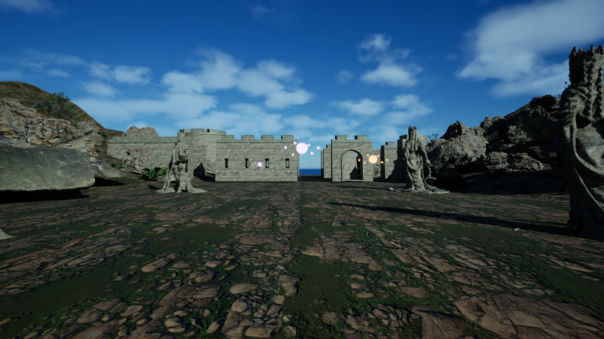

# ASHBOUND native 3D technical demo

ASHBOUND is an independent first-person fantasy-world prototype built with Unreal Engine 5.8. The Windows technical demo opens inside a walkable, sculpted ash valley with a stone fort, animated ambient wisps, dynamic lighting and three castable visual spell schools. It is a native executable, separate from the browser-based ASHBOUND research page. The intended full game is still in development.



**Controls:** WASD to move, mouse to look, Space to jump, Q for Resonance, E for Ember, R for Reweave, Esc to leave the game. Spell orbs travel toward the player's aim point and change their light, colour and orbit by school. Resonance leaves a temporary echo beacon, Ember lights the destination, and Reweave grows a fern there. These are small, time-limited world effects, not a complete magic system. This preview does not yet contain NPC AI, quests, books, combat progression, a market, saves or a full open world. It is not an Elder Scrolls or Morrowind modification, and contains none of those games' assets.

## Build from source

Requirements: Windows x64, Unreal Engine 5.8 installed with its first-person Blueprint template and high-content template resources, Visual Studio C++ toolchain, Python 3, and network access to Poly Haven for the listed CC0 assets. The build needs substantial temporary disk space. The source tree intentionally excludes downloaded art, generated Unreal `.uasset` files, cooked content and binaries.

From the repository root in PowerShell:

```powershell
& .\native\ashbound-unreal\bootstrap.ps1 -EngineRoot 'C:\Program Files\Epic Games\UE_5.8'
& .\native\ashbound-unreal\package.ps1 -EngineRoot 'C:\Program Files\Epic Games\UE_5.8'
```

`bootstrap.ps1` verifies the public asset manifest, checks and downloads 39 additional Poly Haven files against `asset-manifest.json`, copies Epic's installed first-person template content, compiles the native module and authors the 3D map in Unreal. It writes generated files below `.local-qa/ashbound-unreal` and refuses to overwrite an existing project. `package.ps1` cooks a Development Windows build to a fresh output folder and requires `-skipzenstore` on this tested UE 5.8 configuration. Both scripts accept an alternate `-WorkRoot`; `package.ps1` also accepts `-OutputRoot`.

The scripted map, terrain and three living spell actors are in `tools/` and `Source/`. The 39 downloaded art files are bound by SHA-256, size and URL in `asset-manifest.json`; six other visual sources already in this repository are checked against the public web asset manifest. The additional art is [Poly Haven CC0](https://polyhaven.com/license). Epic's first-person template content is supplied by the local engine installation, not committed here.

## Verified preview scope

- Unreal editor C++ build succeeded on Windows with UE 5.8.
- The map authoring receipt recorded 567 world actors. A packaged Windows Development build completed successfully and launched locally.
- A timed native capture showed the first-person 3D fort scene and a grown plant. The packaged runtime log showed a possessed first-person pawn, all three spell casts and each school's world effect. The screenshot above is from the native runtime, not a mock-up.
- Keyboard Q/E/R input is bound in code. Manual end-to-end interaction for every school, performance across other GPUs, longer play sessions, installer behaviour and accessibility have not yet been established.

The next game-development pass should deepen the consequences of each spell, add meaningful exploration and readable in-world lore. This preview establishes the native 3D renderer, controllable first-person traversal and an authored world that can be iterated without falling back to a flat arena.
