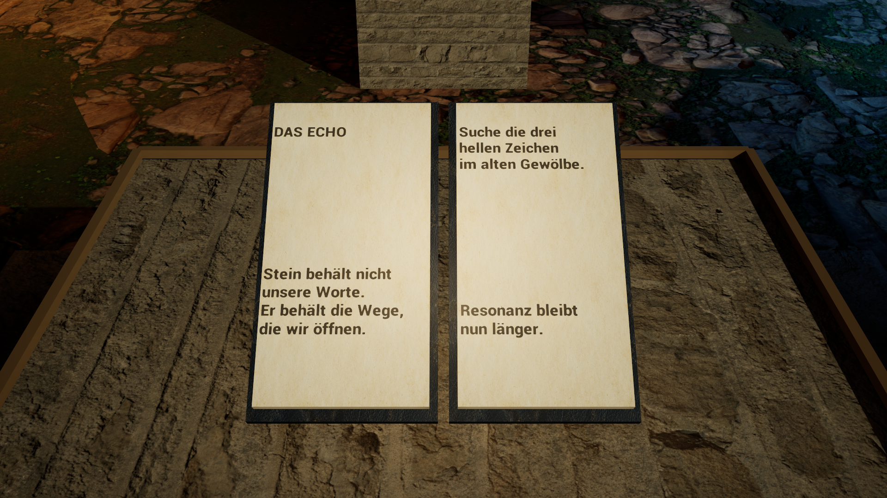

# ASHBOUND — native Windows game candidate

The separate **GenesisWorld** landscape candidate can be opened with
`& .\native\ashbound-unreal\play-genesis.ps1 -PackageRoot '<local package directory>'`.
Use `-Lighting Balanced` for the measured 1440p option without dynamic global
illumination; omit it for the unchanged Epic lighting. `-Width` and `-Height`
select the display resolution. On the reference PC, one stationary packaged
Genesis view measured 26.27 ms/frame in Epic and 19.27 ms/frame in Balanced
(median of the last 300 CSV frames). This does not establish moving-world FPS
or visual acceptance. The current candidate still has conspicuous colour and
repetition problems on distant slopes.

ASHBOUND is an independent first-person Unreal Engine 5.8 game in development. This local Windows build has a walkable ash valley, a ruined archive, three spell schools, three readable 3D books and a three-seal passage into the fort. Chapter I now starts with an in-world witness: speak to her, read Ilyra's book, awaken the three seals, cross the gate and reach the fort. A small HUD and **J** journal show the current goal without hiding the world. The witness conversation, charged seals and chapter completion are saved and reconstructed when the game starts again. Reaching the fort closes this opening chapter. It runs as a native EXE with DX12/SM6, Lumen and virtual shadow maps. The browser research pages are separate from this game.
The local reference profile starts at Epic scalability and 100% internal render resolution. **2560 × 1440 is the current visual performance target, not a resolution cap.** Display resolution follows the monitor; 4K and 8K remain selectable through the engine and game-user settings. Their frame rates and image quality need separate measurements on the target hardware.
On the reference PC (Ryzen 7 9700X, RTX 4070 SUPER, 61.6 GiB RAM), an earlier packaged Development candidate rendered the archive gate view offscreen at 2560 × 1440, Epic quality and 100% internal resolution: 540 sampled frames after warm-up had a 10.90 ms median and 12.36 ms 95th-percentile frame time. That historical Chapter I sample is separate from the Genesis measurements above; neither stationary sample guarantees moving-world frame rate.



The central passage follows a sculpted and rutted collision mesh rather than a flat cube. The valley is carved beneath the playable lane, so its collision surface no longer covers the ruts. Portal bases, seals and large stones sample that same triangulated ground reference; large props use a footprint rather than only their centre. Low rubble and wind-displaced ferns break up the road shoulder. The genesis light sits on a stone source, and pressing **B** produces short-lived light traces on nearby ground and two fern islands. The remaining visual ground-contact and progression observations are recorded in [WORLD_CONTACT.md](WORLD_CONTACT.md). These visual effects are session-bound; arbitrary world-state persistence and gradual material weathering are still future work.

Move with WASD and mouse; Space jumps. The witness stands left of the road before the western archive portal; face her and press **F** to speak. Press **J** to show or hide the journal. Cast Resonance with **Q**, Ember with **E**, and Reweave with **R**. Press **B** near the entrance to pulse the genesis core: three coloured traces emerge briefly from the grounded source. Face an archive book and press **F** to read or turn its page; **Escape** leaves the reading view. Aim at the loose metal dagger beside *Kaels Uhrschrift* and press **M** to draw it toward your view; press **M** again to release it to gravity. Books and desks are not magnetizable. The three volumes use the existing ASHBOUND texts from `forschung/ashbound/play/books.mjs`. Each has a distinct learned effect: Ilyra extends Ember light from 24 to 60 seconds, Neral extends the Resonance echo from 18 to 45 seconds, and Kael lets Reweave growth persist for the current session. Learned volumes are saved locally and restored when the game starts again. Reweave grows a nine-frond grove over 2.2 seconds; the oldest grove is recycled after 24 casts so growth stays responsive. Match the three coloured archive seals to the three spells to raise the east gate. Flying spells resolve at their first blocking impact and produce light, echoes or growth in the 3D world.

After meeting the witness, face her nearby and press **T** for one optional locally generated line. This sends only the current chapter stage, number of studied books, archive decision and fungal-home vitality to a locally running Ollama `qwen2.5:14b` at `127.0.0.1:11434`; no model or service is bundled with the EXE. The request is asynchronous, and an authored line appears if Ollama is unavailable or returns an invalid response. Generated lines are transient dialogue, not saved game facts or new quests. The first fungal home near the archive path changes its shape and light with vitality; Reweave nurtures it when cast nearby.

Continue east beyond the fort to enter the expanding wilderness. The native runtime creates and unloads deterministic 128-metre terrain cells with grounded rocks, trees, ferns and grass while keeping nearby cells active. This is a traversable terrain foundation, not a populated open-world campaign: the wilderness has no settlements, NPC schedules, authored quests or saved player position yet.

## World rebuild

The separate FoundationLab experiment was rejected after visual review: coarse
generated terrain and near-uniform ground texturing read as a flat painted
surface despite 3D collision. Its code and active build entry have been removed.
`/Game/ASHBOUND/Maps/RebirthGrove` is a separate Unreal Landscape and World
Partition candidate, authored from the engine's Open World template. It uses a
world-space 2K ground material and ground-traced instanced habitat. It is included
for native visual QA, but the default playable Chapter I map remains Prologue.
The RebirthGrove screenshot is a development observation, not approval of the
art direction, 5 × 5 km coverage, a finished open world or target performance.
Its current vegetation, terrain composition and object materials still need
substantial art work before it can replace the Chapter I scene.
After bootstrapping, run `& .\native\ashbound-unreal\play-rebirth.ps1 -WorkRoot '<your empty build directory>'`
to enter this landscape directly in the native first-person runtime. The current
packaged Development EXE can be opened with the same script using
`-PackageRoot '<your package directory>'` instead of `-WorkRoot`.
The current
scene has ground collision and a short, grounded habitat near the spawn; it does
not yet carry the Chapter I quest, a 5 × 5 km authored world, digging, or saved
world state. The visual QA screenshot is generated locally by the optional
`-ashboundshot` Development argument.

## Build locally

Windows x64 needs Unreal Engine 5.8 with its first-person Blueprint template and high-content template resources, a Visual Studio C++ toolchain, Node.js, Python 3 with Pillow, and space for the generated project. From the repository root in PowerShell:

```powershell
& .\native\ashbound-unreal\bootstrap.ps1 -EngineRoot 'C:\Program Files\Epic Games\UE_5.8'
& .\native\ashbound-unreal\package.ps1 -EngineRoot 'C:\Program Files\Epic Games\UE_5.8'
& .\native\ashbound-unreal\verify-package.ps1
```

`bootstrap.ps1` creates a fresh, isolated Unreal project; `package.ps1` cooks a Windows Development build into a fresh output directory. They accept `-WorkRoot`, and the packaging script accepts `-OutputRoot`. Existing project or output paths are refused. The build verifies 61 downloaded Poly Haven source files against SHA-256, size and URL entries in `asset-manifest.json`; the sources are [CC0](https://polyhaven.com/license). The book's paper and leather images in `art/materials/` were generated specifically for this project. Page art is typeset from the project's existing stories using Libre Baskerville (`art/fonts/OFL.txt`). Epic template assets come from the local engine installation. Generated `.uasset` files and executable packages stay outside Git.
Pass `-Configuration Shipping` to `package.ps1` for a player-facing package without the Development QA switches.

The native source lives in `Source/`, world authoring and asset import in `tools/`, and renderer settings in `Config/`. The current play area is a vertical slice: it saves acquired book knowledge and Chapter I facts, but does not yet persist arbitrary world changes, character position or inventory. NPC AI, a full open world and final character animation are still missing. The witness is a scripted stone character for the opening; future characters need behavior, animation and authored dialogue. Frame measurements for one scene and this PC do not establish a stable frame rate for a completed game; the current run record is kept with the local build, not presented as a universal hardware requirement.

The bootstrap reopens the saved level and checks terrain, portal collision and surface-texture settings in `world_assets_verified.json`. OpenGL normal maps flip their green channel for Unreal; roughness maps use linear mask compression. `verify-package.ps1` runs a packaged Development build with a null renderer and checks terrain traces, player-sized Pawn sweeps through the archive doorway and against its stone sides, spell material and three world-effect receipts. That probe does not measure FPS or replace a visual play test.
